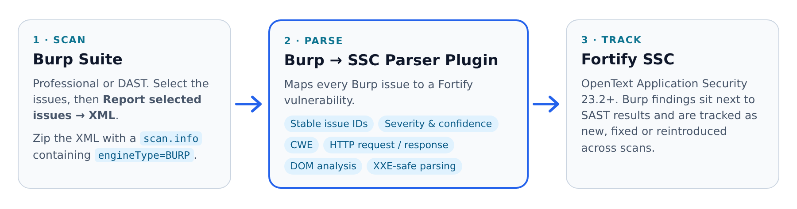

<div align="center">
  <picture>
    <source media="(prefers-color-scheme: dark)" srcset="docs/images/logo-dark.png">
    
  </picture>
  <h1>Burp Suite Parser Plugin for Fortify SSC</h1>
  <p><b>Import PortSwigger Burp Suite scan results into Fortify Software Security Center (OpenText Application Security)</b>, with stable issue tracking across scans, CWE and HTTP evidence in the issue view.</p>

  <p>
    <a href="https://github.com/ptkvaibhav/burp-fortify-ssc-parser-plugin/releases/latest"></a>
    <a href="https://github.com/ptkvaibhav/burp-fortify-ssc-parser-plugin/actions/workflows/ci.yml"></a>
    <a href="https://github.com/ptkvaibhav/burp-fortify-ssc-parser-plugin/actions/workflows/codeql.yml"></a>
    
    
    
  </p>
  <sub>Independent community project. Not affiliated with, endorsed by or supported by OpenText or PortSwigger. <a href="#-trademarks--affiliation">Details</a></sub>
</div>

---

## 📖 Overview

Teams that test web applications with **Burp Suite** often manage everything else in **Fortify SSC**. This plugin closes the gap: upload a Burp XML export to an SSC application version and every Burp finding becomes a tracked SSC issue, next to your SAST results, with its own audit history.

<picture>
  <source media="(prefers-color-scheme: dark)" srcset="docs/images/how-it-works-dark.png">
  
</picture>

### ✨ Key Features
- **Stable issue tracking:** issue IDs are derived from the issue name, host, path and location, so SSC correctly marks findings as new, existing, fixed or reintroduced across scans. IDs are locked by tests and have been identical since 2.0.0.
- **Faithful mapping:** Burp severity maps one-to-one to Fortify priority (High → High, Medium → Medium, Low/Information → Low), and Burp confidence maps to Fortify confidence (Certain 5, Firm 3, Tentative 1).
- **Evidence in SSC:** the HTTP request and response (all pairs, Base64 or plain text), **CWE IDs**, vulnerability classifications, references and DOM-based **dynamic analysis** (source, sink, proof of concept) appear in the issue view.
- **Correct scan dates:** the SSC scan date comes from Burp's export time, not the upload time.
- **Clear errors for the wrong export:** Burp's *Save items* file (HTTP history, not findings) is rejected with a message saying which export to use, instead of importing every request as a bogus issue.
- **Secure by design:** XXE- and entity-expansion-safe XML parsing, and HTML from the scanned application is escaped before it is shown in SSC.
- **Never rejected by SSC for size:** every field is kept within the plugin-API limits (20,000 characters for long text), with a visible truncation note.
- **Verifiable without SSC:** an offline SSC simulator checks the packaged JAR against real Burp exports (`./gradlew verifyReport`).

---

## 🚀 Quick start

1. **Download** `burp-fortify-ssc-parser-plugin-<version>.jar` from the [latest release](https://github.com/ptkvaibhav/burp-fortify-ssc-parser-plugin/releases/latest). Verify it against the published `.sha256` file if you like.
2. **Install it:** in SSC go to **Administration > Plugins > Parsers**, click **Add**, upload the JAR, then select the **Burp Suite Parser Plugin** and click **Enable**.
3. **Upload a scan:**
   1. In Burp, select the issues, right-click, and choose **Report selected issues** → **XML**. Keeping *Base64-encode requests and responses* on is recommended, but both settings work.
   2. Create a text file named `scan.info` that contains exactly:
      ```text
      engineType=BURP
      ```
   3. Zip the XML and `scan.info` together, for example `results.zip`, and upload it to your application version in SSC.

### What you see in SSC

| Section | Fields |
| --- | --- |
| Burp Suite Details | Issue name, Burp severity and confidence, URL / path, **CWE** |
| HTTP Request / HTTP Response | All evidence pairs, decoded and shown as text |
| Technical Details | Issue detail and background, remediation detail and background, **dynamic analysis (DOM)** |
| Classifications & References | Burp's CWE/CAPEC classifications and reference links |

---

## ✅ Compatibility

| Component | Supported | Notes |
| --- | --- | --- |
| Fortify SSC / OpenText Application Security | **23.2 – 26.x** | The plugin is compiled for Java 17, and SSC runs on JDK 17 from 23.2 onwards; earlier releases run on Java 11 and cannot load it. It is built against the latest published `plugin-api` (1.2.2320.0) but uses only API 1.0 features, and its manifest validates against the official `pluginmanifest-1.0.xsd`. |
| Burp Suite Professional / DAST | 1.6 – 2025.x XML exports | *Report selected issues → XML* (`<issues>` root). Elements the plugin does not use (e.g. `collaboratorEvent`, `staticAnalysis`) are ignored. Burp's *Save items* export is HTTP history, not scan results, and is rejected with guidance. |

> **Upgrading:** upload the new JAR, disable the old version, then enable the new one (SSC allows only one enabled version per plugin). Issue IDs are unchanged, so audit history is kept. 2.1.0 adds new fields (`data-version` 2): they are filled in from the next upload onwards, and SSC will not let you go back to a 2.0.x version afterwards.

### Verifying without access to SSC

`./gradlew verifyReport` loads the **packaged plugin JAR** the way SSC does: it discovers the plugin through `META-INF/services`, with only the libraries SSC provides on the classpath. It then pushes your Burp exports or SSC upload ZIPs through an offline SSC simulator. The simulator enforces SSC's parser contract: unique and stable IDs, every vulnerability completed, mandatory fields set, only declared attributes used and kept within the plugin-API length limits, `completeScan()` called, and the right engine type. It exits non-zero if SSC would reject anything.

```bash
./gradlew verifyReport -Preport=/path/to/burp-results.xml,/path/to/results.zip
```

`./gradlew build` also validates `plugin.xml` against the official XSD, checks the view template and localization, and verifies the JAR layout.

### Releases

Pre-built JARs are attached to [GitHub Releases](https://github.com/ptkvaibhav/burp-fortify-ssc-parser-plugin/releases). A release is published automatically when a new `version` (in `build.gradle` and `plugin.xml`) reaches `main` with a matching `CHANGELOG.md` section. The workflow builds and tests the plugin, runs `verifyReport` on the packaged JAR, and publishes the tag, the JAR and its SHA-256.

---

## ⚖️ How this differs from the official Fortify Burp parser

OpenText maintains its own open-source Burp parser, [`fortify/fortify-ssc-parser-burp`](https://github.com/fortify/fortify-ssc-parser-burp). It is a good choice if your organisation only allows vendor-maintained plugins. The table below compares it, **as of its v1.1.0 (August 2026)**, with this plugin:

| | This plugin | Official `fortify-ssc-parser-burp` v1.1.0 |
| --- | --- | --- |
| Maintained by | Community (this repository) | OpenText |
| Engine type in `scan.info` | `BURP` | `BURP_XML` |
| Wrong export (*Save items* HTTP history) | Rejected with a message naming the right export | Parses no issues; no specific message from the parser |
| Issue ID | Hash of name + host + path + location | Burp `serialNumber` |
| Severity → priority | One-to-one (High → High, …) | Raised one level (High → Critical, Low → Medium, …) |
| Confidence | Mapped from Burp (Certain / Firm / Tentative) | Fixed value |
| Request / response encoding | Honours Burp's `base64` flag | Assumes Base64 |
| HTTP evidence display | HTML-escaped; all pairs | Inserted as-is; single pair field |
| CWE as its own field | Yes | Included in the references text |
| Dynamic analysis (DOM) | Yes | Yes |
| Declared supported Burp versions | Not restricted | `[2019.0, 2020.5]` |
| Automated output verification | Assertion-based tests and an offline SSC contract simulator | Tests run the parser without checking its output |

Because the plugin IDs and engine types differ, **both plugins can be installed in the same SSC instance**, so you can evaluate this one without removing the official parser.

---

## 🛠️ Development & Architecture

- **`BurpParserPlugin.java`**: entry point implementing `ParserPlugin<T>`. Handles scan metadata, issue mapping, truncation and duplicate prevention.
- **`BurpContentFormatter.java`**: Base64 handling, HTML escaping, safe truncation, CWE extraction and export-time parsing.
- **`BurpItems` / `BurpItem` / `BurpRequestResponse` / `BurpHttpMessage` / `BurpDynamicAnalysis`**: Jackson XML models of the Burp export.
- **`BurpVulnerabilityAttribute.java`**: custom attributes shown in SSC. Display names live in `resources/messages_en.properties`, and the layout in `viewtemplate/ViewTemplate.json`.

```bash
git clone https://github.com/ptkvaibhav/burp-fortify-ssc-parser-plugin.git
cd burp-fortify-ssc-parser-plugin
./gradlew clean build   # JDK 17; produces build/libs/burp-fortify-ssc-parser-plugin-<version>.jar
```

> `build/libs/` also contains a `*-plain.jar` (unshaded classes only). Do **not** upload that one to SSC.

### Code Quality
- **Full check:** `./gradlew build` compiles the code, runs the tests and Checkstyle (main and test) and JaCoCo coverage, validates the plugin manifest, checks the JAR layout and produces the shaded plugin JAR.
- **Tests:** JUnit Jupiter 6 and Mockito. They cover mapping, ID stability, encodings, escaping, truncation, locale and time-zone independence, XXE hardening and the SSC contract.
- **Dependency scan:** `./gradlew dependencyCheckAnalyze` runs OWASP Dependency-Check and fails on CVSS ≥ 7.0. Supplying an [NVD API key](https://nvd.nist.gov/developers/request-an-api-key) via `NVD_API_KEY` is strongly recommended.

---

## 🤝 Contributing

Contributions are welcome. See the [Contributing Guidelines](CONTRIBUTING.md) and the [Code of Conduct](CODE_OF_CONDUCT.md). Please never attach real scan data to issues or pull requests.

## 🛡️ Security

To report a vulnerability, see the [Security Policy](SECURITY.md). Please use private reporting, not public issues.

## 💬 Support

See the [Support Guide](SUPPORT.md) and the [Wiki](WIKI.md) for troubleshooting.

## 📄 License

MIT. See [LICENSE](LICENSE).

## ™ Trademarks & affiliation

This is an independent, community-maintained open-source project. It is **not affiliated with, endorsed by, sponsored by or supported by OpenText** (owner of Fortify) **or PortSwigger Ltd** (owner of Burp Suite). Fortify, Fortify Software Security Center and OpenText are trademarks of Open Text Corporation or its affiliates. Burp Suite and PortSwigger are trademarks of PortSwigger Ltd. These names are used only to describe the products this plugin works with. The plugin's icon and logo are original artwork. For help with Fortify SSC or Burp Suite themselves, contact the respective vendor.
